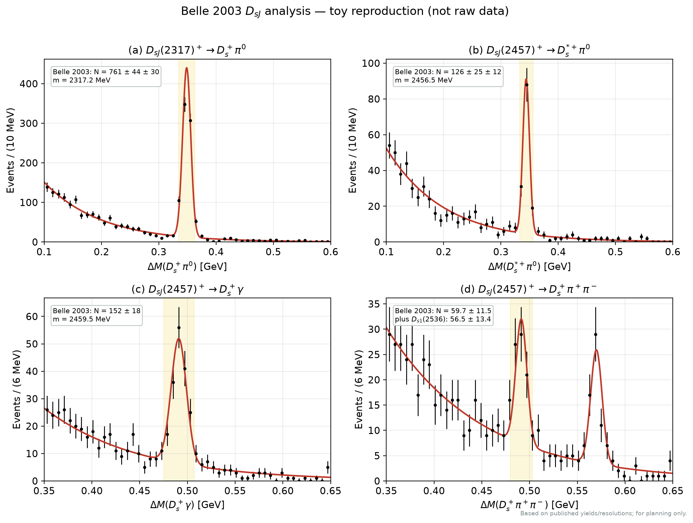
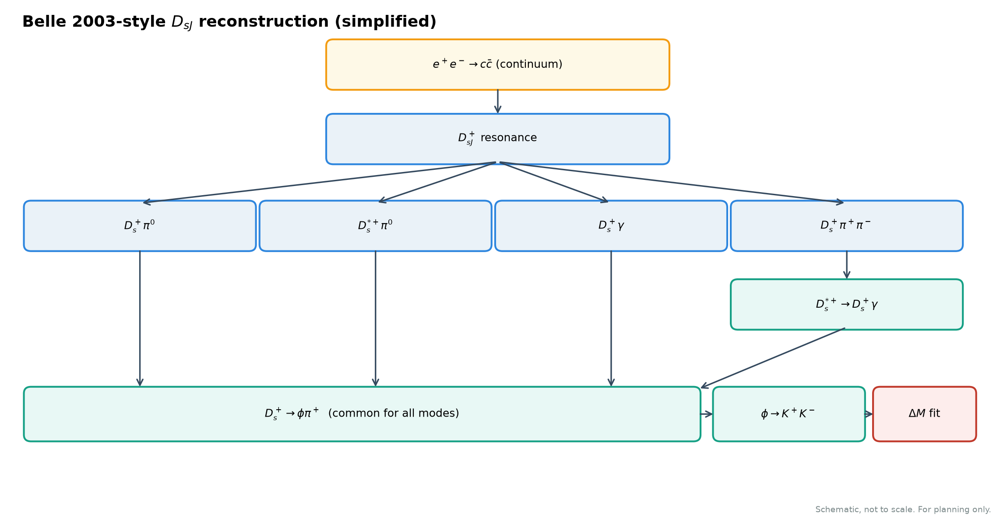
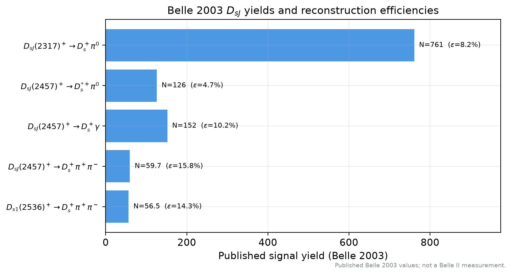

# 简化路线：Belle 2003 式 $D_{sJ}$ 直接重建

> 这一章回应黄仪伟/杨昊中的建议：**先不做复杂的 B 衰变振幅分析，先用 2003 Belle 的 $D_{sJ}$ 直接重建路线，dataset 少、步骤清楚。**
>
> **重要说明**：本章的数值和图像是**基于 Belle 2003 论文公开结果做的文献复现/玩具图**，不是对 Belle 或 Belle II 原始数据的重新分析。我们没有 86.9 fb$^{-1}$ 的 Belle 数据，也没有 Belle II 的 ntuple。

---

## 1. 为什么先做这个

之前的方案是：

$$
B\to \bar D^{(*)}D_{s1}(2460),\qquad D_{s1}\to D_s\pi\pi,
$$

然后做 Dalitz 振幅。这个路线物理丰富，但复杂度高：

- 需要 B 衰变重建、$D^*$、$D_{s1}$、B 顶点；
- 需要 $M_{\rm bc}$、$\Delta E$、ROE/CS、FastBDT；
- 需要振幅模型、效率图、本底 PDF；
- 数据集多、系统误差多。

黄仪伟建议参考 2003 Belle 的 $D_{sJ}$ 分析：

> Y. Mikami et al. (Belle), *Measurements of the $D_{sJ}$ resonance properties*, arXiv:hep-ex/0307052.

它的思路是**直接在 continuum $e^+e^-\to c\bar c$ 中重建 $D_{sJ}$**：

$$
e^+e^-\to c\bar c\to D_{sJ}^+X,
$$

$$
D_{sJ}^+\to D_s^+\pi^0,\quad D_s^{*+}\pi^0,\quad D_s^+\gamma,\quad D_s^+\pi^+\pi^-,
$$

$$
D_s^+\to\phi\pi^+,\qquad \phi\to K^+K^-.
$$

优点：

- 不需要重建 B；
- 数据集少；
- cut 和拟合都更简单；
- 2003 Belle 和 Belle II 更相似（同一类 $e^+e^-$ 实验）；
- 可以先建立“会做 $D_s$、$\phi$、$\pi^0$、$\gamma$、$\Delta M$ 拟合”的基本功。

---

## 2. 2003 Belle 分析的核心参数

| 项 | 值 |
|---|---|
| 数据 | $86.9\ \mathrm{fb}^{-1}$，$\sqrt{s}=10.6\ \mathrm{GeV}$ |
| $D_s^+$ 衰变 | $D_s^+\to\phi\pi^+$，$\phi\to K^+K^-$ |
| $D_{sJ}(2317)^+$ | 质量 $2317.2\pm0.5\pm0.9\ \mathrm{MeV}$，$\Gamma<4.6\ \mathrm{MeV}$（90% CL） |
| $D_{sJ}(2457)^+$ | 质量 $2456.5\pm1.3\pm1.3\ \mathrm{MeV}$，$\Gamma<5.5\ \mathrm{MeV}$（90% CL） |
| $D_{sJ}(2317)$ 衰变 | 只观察到 $D_s^+\pi^0$；辐射/双 $\pi$ 衰变给上限 |
| $D_{sJ}(2457)$ 衰变 | $D_s^{*+}\pi^0$、$D_s^+\gamma$、$D_s^+\pi^+\pi^-$ 都观察到 |

---

## 3. 选择条件（2003 Belle cut）

> 这些是 2003 Belle 的 cut；Belle II 需要重新优化。  
> 表中的 $P(K/\pi)$ 是 Belle 的 kaon/pion 似然比；basf2 里对应 `kaonID` / `pionID` 的工作点，不是同一个变量。

| 对象 / 变量 | 筛选条件 | 作用 |
|---|---|---|
| $\phi\to K^+K^-$ | 两条异号径迹；一条 $P(K/\pi)>0.5$，另一条 $>0.2$ | kaon 鉴别 |
| $\phi$ 质量窗 | $\lvert M(K^+K^-)-m_\phi\rvert<10\ \mathrm{MeV}$ | 选择 $\phi$ |
| $\phi$ 螺旋角 | $\lvert\cos\theta_H\rvert>0.35$ | 抑制组合本底 |
| $D_s^+$ 中的 bachelor $\pi^+$ | $P(K/\pi)<0.9$ | pion 鉴别 |
| $D_s^+$ 质量窗 | $\lvert M(\phi\pi^+)-m_{D_s}\rvert<10\ \mathrm{MeV}$ | 选择 $D_s^+$ |
| $D_{sJ}$ 质心系动量 | $p^*(D_s\pi\pi)>3.5\ \mathrm{GeV}$ | 去除 $B\bar B$ 事例贡献 |
| $D_{sJ}$ 衰变中的两条 pion | 至少一条 $p^*>0.300\ \mathrm{GeV}$ | 抑制低动量组合本底 |
| 上述两条 pion 的 PID | 一条 $P(K/\pi)<0.1$，另一条 $<0.9$ | 抑制 kaon 误鉴别 |
| $K_S^0$ veto | $\lvert M(\pi^+\pi^-)-m_{K_S^0}\rvert\ge15\ \mathrm{MeV}$ | 去除 $K_S^0$ 背景 |
| 多候选 | 保留多个候选，不作唯一候选选择 | 论文明确说明 |

### 3.1 为什么 $p^*>3.5$ GeV

在 Belle/Belle II 的 continuum $e^+e^-\to c\bar c$ 中，$D_{sJ}$ 来自 $c\bar c$ 事例，能量较高；而 $B\bar B$ 事例中的 $D_{sJ}$ 动量较低。$p^*>3.5\ \mathrm{GeV}$ 是去除 $B\bar B$ 贡献的关键 cut。

### 3.2 为什么保留多候选

2003 Belle 明确**不做唯一候选选择**，而是保留所有候选，在拟合中处理多候选。这样避免 best-candidate 选择带来的偏差。Belle II 版本也应先保留多候选，再在系统误差里比较。

---

## 4. 重建链与 $\Delta M$

### 4.1 $D_s^+\to\phi\pi^+$

$$
\phi\to K^+K^-,\qquad D_s^+\to\phi\pi^+.
$$

### 4.2 $D_s^{*+}$

$$
D_s^{*+}\to D_s^+\gamma
$$

（也可以用 $D_s^{*+}\to D_s^+\pi^0$，但 2003 分析主要用 $\gamma$。）

### 4.3 $D_{sJ}$ 的四个衰变模式

$$
D_{sJ}^+\to D_s^+\pi^0,
$$

$$
D_{sJ}^+\to D_s^{*+}\pi^0,
$$

$$
D_{sJ}^+\to D_s^+\gamma,
$$

$$
D_{sJ}^+\to D_s^+\pi^+\pi^-.
$$

对应的质量差：

$$
\Delta M(D_s^+\pi^0)=M(D_s^+\pi^0)-M(D_s^+),
$$

$$
\Delta M(D_s^{*+}\pi^0)=M(D_s^{*+}\pi^0)-M(D_s^{*+}),
$$

$$
\Delta M(D_s^+\gamma)=M(D_s^+\gamma)-M(D_s^+),
$$

$$
\Delta M(D_s^+\pi^+\pi^-)=M(D_s^+\pi^+\pi^-)-M(D_s^+).
$$

用 $\Delta M$ 而不是直接质量，可以抵消一部分 $D_s$ 质量分辨率。

---

## 5. 2003 Belle 的结果

### 5.1 拟合方法

对每个 $\Delta M$ 分布：

- 信号：Gaussian（分辨率由 MC 或数据控制样本确定）；
- 本底：二阶/三阶多项式；
- 用 sideband 约束本底形状；
- 拟合产额、峰位、宽度；
- 对 $D_{sJ}(2317)$，还要处理来自 $D_{sJ}(2457)$ 的 feed-down；
- 对 $D_{sJ}(2457)$，还要处理 $D_s^*$ 光子漏掉/替换造成的 feed-up / broken-signal。

2003 Belle 的关键拟合结果：

- $D_{sJ}(2317)$：$N=761\pm44\pm30$，$\Delta M=348.7\pm0.5\ \mathrm{MeV}$，$\sigma=7.6\pm0.5\ \mathrm{MeV}$；
- $D_{sJ}(2457)\to D_s^*\pi^0$：$N=126\pm25\pm12$，$\Delta M=344.1\pm1.3\ \mathrm{MeV}$，$\sigma=5.8\pm1.3\ \mathrm{MeV}$；
- $D_{sJ}(2457)\to D_s\gamma$：$N=152\pm18$，$\Delta M=491.0\pm1.9\pm1.9\ \mathrm{MeV}$；
- $D_{sJ}(2457)\to D_s\pi\pi$：$N=59.7\pm11.5$，$\Delta M=491.4\pm0.9\pm1.5\ \mathrm{MeV}$；
- $D_{s1}(2536)\to D_s\pi\pi$：$N=56.5\pm13.4$。

### 5.2 分支比与上限

$$
\frac{\mathcal B(D_{sJ}(2457)\to D_s\gamma)}
{\mathcal B(D_{sJ}(2457)\to D_s^*\pi^0)}
=0.55\pm0.13(\mathrm{stat})\pm0.08(\mathrm{syst}),
$$

$$
\frac{\mathcal B(D_{sJ}(2457)\to D_s\pi\pi)}
{\mathcal B(D_{sJ}(2457)\to D_s^*\pi^0)}
=0.14\pm0.04(\mathrm{stat})\pm0.02(\mathrm{syst}).
$$

上限（90% CL）：

$$
\frac{\mathcal B(D_{sJ}(2317)\to D_s\gamma)}
{\mathcal B(D_{sJ}(2317)\to D_s\pi^0)}<0.18,
$$

$$
\frac{\mathcal B(D_{sJ}(2317)\to D_s\pi\pi)}
{\mathcal B(D_{sJ}(2317)\to D_s\pi^0)}<4\times10^{-3}.
$$

### 5.3 系统误差

| 来源 | 处理 | 量级 |
|---|---|---|
| $\pi^0$ 能量标定 | 用 $D_s^{*+}\to D_s^+\pi^0$ 控制样本 | $\pm0.6\ \mathrm{MeV}$ |
| feed-down / feed-up 本底 | 变 MC 参数、变 $D_{sJ}(2457)$ 产额 | 按拟合变化赋值 |
| 非 cross-feed 本底 | 变多项式阶数 | 按拟合变化赋值 |
| MC 输入/输出差异 | 比较 MC 生成和重建 | 按差异赋值 |
| $D_s$/$D_s^*$ 世界平均质量 | 变输入质量 | 按 PDG 误差 |
| 亮度 | 官方 | 约 1.5%（截面测量） |
| MC 统计 | 子样本 | 按统计误差 |

> 这些是 2003 Belle 的系统误差；Belle II 需要重新做 PID、tracking、$\gamma/\pi^0$、trigger 等系统误差。

### 5.4 结果表

| 量 | 结果 |
|---|---|
| $D_{sJ}(2317)\to D_s^+\pi^0$ 产额 | $761\pm44\pm30$ |
| $D_{sJ}(2457)\to D_s^{*+}\pi^0$ 产额 | $126\pm25\pm12$ |
| $D_{sJ}(2457)\to D_s^+\gamma$ 产额 | $152\pm18$ |
| $D_{sJ}(2457)\to D_s^+\pi^+\pi^-$ 产额 | $59.7\pm11.5$ |
| $D_{s1}(2536)\to D_s^+\pi^+\pi^-$ 产额 | $56.5\pm13.4$ |
| $D_{sJ}(2457)$ 辐射/$\pi^0$ 比 | $0.55\pm0.13\pm0.08$ |
| $D_{sJ}(2457)$ 双 $\pi$/$\pi^0$ 比 | $0.14\pm0.04\pm0.02$ |
| $D_{sJ}(2317)$ 辐射/$\pi^0$ 上限 | $<0.18$（90% CL） |
| $D_{sJ}(2317)$ 双 $\pi$/$\pi^0$ 上限 | $<4\times10^{-3}$（90% CL） |

探测效率：

| 模式 | 效率 |
|---|---|
| $D_{sJ}(2317)\to D_s\pi^0$ | 8.2% |
| $D_{sJ}(2457)\to D_s^*\pi^0$ | 4.7% |
| $D_{sJ}(2457)\to D_s\gamma$ | 10.2% |
| $D_{sJ}(2457)\to D_s\pi\pi$ | 15.8% |
| $D_{s1}(2536)\to D_s\pi\pi$ | 14.3% |

---

## 6. Belle II 适配：需要改什么

### 6.1 数据

2003 Belle 用的是 $10.6\ \mathrm{GeV}$ 的 continuum 数据。  
Belle II 主要在 $\Upsilon(4S)$ 运行，$e^+e^-\to c\bar c$ 是 $B\bar B$ 本底下的连续本底，也可以使用离共振数据。

所以：

- 不能直接把 $86.9\ \mathrm{fb}^{-1}$ 的结果按 luminosity 线性放大；
- 需要 **continuum MC** 和 **data sideband**；
- 建议先用 Belle II 的 generic $c\bar c$ MC 做效率，再用数据 sideband 验证；
- skim 不是 hadronic B skim，而是 **continuum/charm skim**（具体名称以 campaign 为准）。

> **不要做这种“naive scaling”**：  
> $761\times(750/86.9)\approx6.6\times10^3$ 只是“如果 Belle II 的 continuum 效率和 Belle 完全一样”的幻想。  
> 实际上 Belle II 在 $\Upsilon(4S)$ 运行，continuum 比例、trigger、PID、$\pi^0$ 效率和 Belle 2003 都不同。必须用 MC 归一化，不能拿这个数当预期产额。

### 6.2 $p^*$ cut

Belle II 的 $\Upsilon(4S)$ 能量与 Belle 的 $10.6\ \mathrm{GeV}$ 略有不同，但 $p^*>3.5\ \mathrm{GeV}$ 仍然是去除 $B\bar B$ 的关键。需要按 Belle II 的 boost 重新确认。

### 6.3 PID

Belle 的 $P(K/\pi)$ 是 likelihood ratio；basf2 用 `kaonID` / `pionID`。  
不要把 2003 的数值直接当 basf2 变量；要用 Belle II 的 PID 工作点重新优化。

### 6.4 多候选

保留多候选；在拟合中处理。不要一上来做 best-candidate。

---

## 7. 图像说明

`figures/` 里的图是**基于 Belle 2003 公开产额和分辨率做的玩具复现图**，不是原始数据：

- `fig_dm_dspi0.png`：$\Delta M(D_s^+\pi^0)$，$D_{sJ}(2317)$；
- `fig_dm_dsstpi0.png`：$\Delta M(D_s^{*+}\pi^0)$，$D_{sJ}(2457)$；
- `fig_dm_dsgamma.png`：$\Delta M(D_s^+\gamma)$，$D_{sJ}(2457)$；
- `fig_dm_dspipi.png`：$\Delta M(D_s^+\pi^+\pi^-)$，$D_{sJ}(2457)$ + $D_{s1}(2536)$；
- `fig_combined.png`：四联图；
- `fig_yields.png`：公开产额/效率；
- `fig_chain.png`：重建链示意图。

> 这些图可以用于**方案/组会**，但不能当成“Belle II 数据结果”发表。  
> 真实的 Belle II 图必须从 ntuple 生成，并带 data/MC 对比和拟合。

*图 1：四联图。基于 Belle 2003 公开产额和分辨率的玩具复现，不是原始数据。*

*图 2：简化重建链。$D_{sJ}$ 的四个衰变模式共用 $D_s^+\to\phi\pi^+$、$\phi\to K^+K^-$，最后做 $\Delta M$ 拟合。*

*图 3：Belle 2003 公开的信号产额和重建效率。不是 Belle II 测量。*

单图：

- [`fig_dm_dspi0.png`](../figures/fig_dm_dspi0.png)
- [`fig_dm_dsstpi0.png`](../figures/fig_dm_dsstpi0.png)
- [`fig_dm_dsgamma.png`](../figures/fig_dm_dsgamma.png)
- [`fig_dm_dspipi.png`](../figures/fig_dm_dspipi.png)

> 生成脚本：`code/figures/make_dsj_figures.py`。  
> 所有图都带 “toy reproduction” 标注；不要去掉这个标注后当真实数据用。

---

## 8. 下一步

1. 在 Belle II 上找 **continuum/charm skim** 的数据和 MC；
2. 先复现 $D_s^+\to\phi\pi^+$ 质量峰；
3. 加 $\pi^0$、$\gamma$、$D_s^{*+}$；
4. 画 $\Delta M$；
5. 用 Gaussian + polynomial 拟合，先看 $D_{sJ}(2317)$；
6. 再考虑 $D_{sJ}(2457)$ 的辐射/双 $\pi$ 模式；
7. 最后再回到 B 衰变/振幅分析。

---

## 9. 参考

- Y. Mikami et al. (Belle), *Measurements of the $D_{sJ}$ resonance properties*, arXiv:hep-ex/0307052.
- 本地 PDF：`references/0307052v2.pdf`。
- PDG：<https://pdg.lbl.gov/>
- Belle II 软件文档：<https://software.belle2.org/development/sphinx/>
